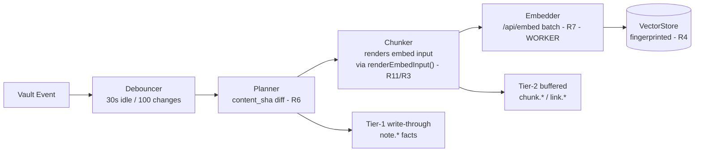
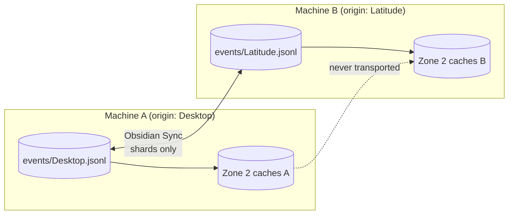
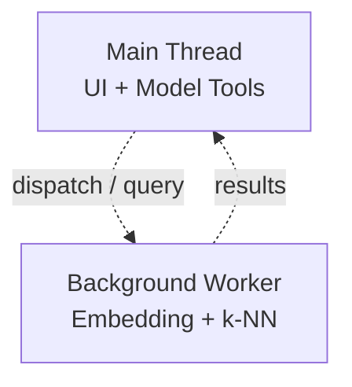

---
source:
status: pending
para:
context:
description:
Topics:
Concepts:
Meeting notes:
Permanent: false
type: note
word_count: 1
language: en
updated:
modified: 2026-10-24T17:58:04+01:00
---
# Vault Overseer — Architecture Map v0.3 (rev. 2026-10-24)

> [!abstract] Purpose Fix structural decisions before subsystem detail. Derived from autopsy of three incumbents, Obsidian Sync behavior verification, and the ratified schema family (Event Log Schema v0.2 rev. 2026-10-24, Chunker Spec v0.1, Event Log Fixture Corpus v0.1 rev. 2026-10-24). **Supersedes Map v0.2.** Changes from v0.2: per-origin event shards, prefixer merged into the chunker via shared `renderEmbedInput()`, event-log API seam between the two plugins made explicit, durability tiers added to the pipeline.
> 
> **Revision 2026-10-24:** folds the shipped-but-unmapped architecture — the origin identity ladder, the dwell gate extraction, rename wiring — plus the ontology ruling and the subscriber-seam commitment. Plugin-folder paths corrected to the actual plugin id (`vault-overseer-index`). No zone model or pipeline change; this revision makes the map describe the project as it exists at 0.1.4/0.1.5-bound.

## Core Constraint from Transport Research

**Obsidian Sync ferry rules:**

- **Syncs everything** in the visible vault
- **Syncs only the canonical quartet** from plugin folders: `manifest.json`, `main.js`, `styles.css`, `data.json`
- **Non-canonical files in plugin folders are structurally excluded** — silent, no error, no retry

**Design consequence:** durable spine and recipes live in the visible vault; rebuildable derived caches live in the plugin folder, structurally excluded from sync. The exclusion is exploited, not fought.

## Zone Definitions

|Zone|Location|Sync Behavior|Contains|Rationale|
|---|---|---|---|---|
|**Zone 1**|Visible vault (`_vault-index/`)|**Full sync**|`events/` (per-origin shards), `recipes/`, `skills/` (user overrides)|Spine + recipes survive machine switch|
|**Zone 2**|Plugin folder (`.obsidian/plugins/vault-overseer-index/cache/`)|**Structurally excluded**|`vectors/`, `bm25/`, `knn-graph/`|Rebuildable caches never travel|
|**Zone 3**|Plugin folder (`.obsidian/plugins/vault-overseer-index/`)|**Quartet only**|`data.json`, `manifest.json`, `main.js` — plus **non-canonical files, notably `origin.txt`** (below)|Settings only — no volatile runtime state (R8)|

> [!note] Revision 2026-10-24 — path correction v0.3's original table said `.obsidian/plugins/vault-overseer/`; the plugin id is **`vault-overseer-index`** (manifest receipt, 0.1.3/0.1.4). Corrected throughout. Zone 3's "Contains" now also names `origin.txt` explicitly: it is a non-canonical file in the plugin folder root, which places it outside the quartet — structurally excluded from Sync and untouched by BRAT's quartet-only updates. That exclusion is what makes it safe to hold per-device identity.

Zone 3 discipline is policed by the log itself: `settings.changed` is the fire alarm, and chatty events there mean runtime state has crept into `data.json`.

## Identity — the Origin Ladder (added 2026-10-24)

The largest piece of architecture shipped since the map froze, previously unmapped: **per-device writer identity**, solved by exploiting the same structural exclusion Zone 2 exploits.

- **Rung 1 — `origin.txt` in the plugin folder.** Non-canonical, sync-excluded, BRAT-proof. If present and non-empty, that's the origin, period.
- **Rung 2 — no `origin.txt` ⇒ writer stays DARK.** The settings surface lists found shards and demands **human certification** (continue an existing shard or declare a new id; a virgin install gets an empty candidate list). No machine ever infers identity from synced state or from the OS. Certification is logged as `origin.migrated-interim`.
- **Rung 3 — deleted (0.1.2).** The former hostname-seeded fallback never called its own write function while claiming it had — a never-fabricate violation, dormant only because no machine ever took it. Identity-by-inference also contradicts the ladder's own principle. Deleted, not repaired.
- **Rung 4 — `data.json`'s origin field is NEVER read.** If ferried in by Sync, it is scrubbed on load and the scrub is logged (`settings.changed-interim`). Auto-lifting it would gamble identity on a sync-conflict coin toss — the S2B lesson, promoted to doctrine.

Shard names are the origin ids: `Desktop.jsonl`, `Latitude.jsonl` in production. A foreign origin value in a shard's tail blocks that machine's writer at startup — misconfigured duplicate ids fail loud, never write.

**Ladder design principles:** identity lives in exactly one place per machine (`origin.txt`), never rides Sync, and never gets fabricated. The map's zone model holds unchanged — the ladder is the zone rules _applied to a new fact class_.

## Indexing Pipeline

> ****

> [!note] Revision 2026-10-27 — implementation status **Shipped:** the spine (EventLog, writer, merge-scan, checkpoints, heal scan, dwell gate, rename wiring) + **File watcher lane** (`src/watcher/watch.ts`, F12-certified, 13 scenarios, 64 checks green) — Tier-1 facts created/deleted via `onVaultCreate`/`onVaultDelete` and automatic reconcile at writer attach. **Heal migrated to `chunkNote` geometry** (2026-10-26), **stub deleted** (2026-10-27, Phase 4). **Still pending:** planner / `note.modified` lane (R6 no-op dedup, F08 blocked), subscriber seam (tail-not-poll commitment), `folder.renamed` event (pending consumer), embeddings + vector store (Phase 3). **The chunker is alive in production** — heal re-derives on every boot (de facto steady-state producer until planner lands); idempotent dedup verified across three reloads (fresh shard: 4,812 lines, zero duplicates).

**Key invariants (v0.3):**

- Planner consults the event log first; unchanged content never re-embeds (same `content_sha` + mtime ⇒ no event, no seq consumed)
- Renames emit `note.renamed` and nothing else — `vh` is path-independent, chunks carry over untouched (R6)
- **The prefixer is not a pipeline stage.** Chunk rendering (`search_document:` prefix + heading chain + frontmatter context + chunk text) happens inside the chunker through the single shared `renderEmbedInput()` — one implementation, not two drifting copies (VC's lesson generalized)
- **Durability is classified:** Tier-1 events (file facts, writes, ops) write through immediately; Tier-2 events (chunks, links, embed batches) flush at 64 events / 3s idle / hard cap 512. Facts survive, derivatives heal

**Additional shipped event sources (2026-10-24):** the dwell gate (`src/dwell/gate.ts` — pure module, injected clock/timer, emit via callback; `main.ts` is a thin adapter) produces `note.opened` (Tier 2) with v1 threshold semantics — F09-certified. Rename wiring (0.1.5-bound) produces `note.renamed` (Tier 1 write-through) on file renames and rewrites gate path lanes in the same handler. Both drop silently while the writer is dark — declared v1 limitation.

## Event Log Topology — the spine

One writer per shard — sync conflicts on the spine are eliminated **by construction** (not a setting, not a promise). Merge-scan orders by `(origin, seq)`; global `ts` is never trusted for ordering. Each machine derives its own caches from the same converged spine.

> [!note] Revision 2026-10-24 — naming corrected v0.3's diagram said `mokka`/`latitude`; production shard names are **`Desktop.jsonl`** and **`Latitude.jsonl`** (live receipts, 2026-10-23/24). Diagram updated to actuals.

**The Plugin 1 ↔ Plugin 2 seam:** Plugin 2 never writes the log directly. It appends via Plugin 1's exposed `appendEvent()` API — single-writer preserved, sequence counter shared, consistent with the "Plugin 2 consumes Plugin 1's API" contract throughout.

**Subscriber seam (committed 2026-10-24, not yet built):** the index will not poll — it **tails** the log. Steady-state, the index is a live subscriber to the event stream: an event commits to disk and fans out to in-process projections in the same notification tick (**notification latency == persistence latency**; Tier-1 write-through means persist and notify ride one operation — no window where the index believes what the disk disputes). Full replay remains the _recovery_ path (cold boot, rebuild, healing), not the steady state. Consequences on the books: the writer's public API grows an inbound tap (`onAppend`/subscriber lane on the serialized queue — fanout ordering inherits the queue's serialization, so subscribers never see events out of causal order); and `folder.renamed` (below) becomes load-bearing the moment this seam exists.

**Ontology ruling (2026-10-24):** folders are **administrative grouping** (PARA etc.); the organic organization is the **link graph** — notes link freely across folders, and the link graph is the index's province, never the spine's. Paths are **storage addresses**, not relationships. This ruling shaped `folder.renamed`'s one-event-not-N-children shape (a folder rename is a single mass-invalidation fact, O(1) to record) and defines the division of labor: the spine records human acts and storage-address changes; the index derives relationships.

**folder.renamed — designed, pending consumer:** a folder rename mass-invalidates every path beneath it. Stock Obsidian emits one `rename` for the folder with no child events; links are maintained, child paths are not. The event awaits the transcription doctrine's consumer (the index's subscriber seam). Until it lands, the gate's prefix rewrite (`renamePrefix`) keeps dwell-truth coherent but the spine records nothing for folder renames — gap accrual is currently **none**, since no index tails the log yet. Full ledger in Schema v0.2 rev. 2026-10-24.

## Skill Path — Diff Gate with Scoped Carve-out (R9/R10)

```mermaid
flowchart LR
    INV["Invocation"] --> SH["SkillHarness<br/>loads recipe - R9"]
    SH --> IN["Gather inputs<br/>(harness, deterministic)"]
    IN --> LLM["LLM"]
    LLM --> VAL["Validate vs contract"]
    VAL --> WG["WriteGate - R10"]
    WG --> RC{"Risk class?"}
    RC -->|"auto-apply-safe:<br/>additive + single field +<br/>empty target + logged"| AA["Auto-apply<br/>notice + write.applied<br/>with before/after"]
    RC -->|"everything else"| DIFF["Diff preview"]
    DIFF --> AP{"Approve?"}
    AP -->|yes| APPLY["Apply + write.applied"]
    AP -->|no| DIS["Discard"]
    AA --> LOG[("events/&#123;origin&#125;.jsonl<br/>actor=plugin")]
    APPLY --> LOG
```

**Hard constraint:** nothing touches a note except through application — validation failure dies before diff; rejection dies before write. Auto-apply writes satisfy all five guardrails (Tool & Skill Strategy, 2026-10-20) and are individually revertible by replay: the prior value travels in the event, and **mechanism precedes policy** — the revert trail exists before any future relaxation needs it.

## Compute Threading Model

- Embedding and k-NN run off-main-thread; a blocked main thread kneecaps model tool calls (observed empirically — this is a v1 invariant, not an optimization)
- Chunking is pure computation and rides the same worker

## Machine Switch — the Spine

The machine-switch story _is_ the shard diagram: new machine gets the synced shards (full text, always traveling via Zone 1), discovers caches absent in Zone 2, rebuilds them locally from the spine. No index file ever crosses the wire; no blob, no tears, no integrity gates. The rebuild is verification of the recipe, not reconstruction of a database.

**Plus the ladder, since 0.1.1:** a new machine boots with no `origin.txt`, finds the shards, and demands human certification before writing a single line — the machine-switch story includes _earning write rights_, not just rebuilding caches. Deleting a shard costs nothing but history; the origin survives (Rung 1) and the writer re-primes from zero on the next certified boot.

## Decisions Logged v0.3 (rev. 2026-10-24)

|Decision|Choice|Reason|Status|
|---|---|---|---|
|Derived cache location|Plugin folder (Zone 2)|Zero config risk; structural exclusion proven|✅|
|Event granularity|Per-chunk metadata, batched writes|Fine-grained replay; buffered flush mitigates growth|✅|
|Spine topology|**Per-origin shards, one writer each**|Sync conflicts eliminated by construction; `(origin, seq)` merge-scan|✅ (v0.3 fold)|
|Chunk text residency|**Metadata only** — offsets + hashes|Text re-derives from synced notes; determinism is the license|✅ (v0.3 fold)|
|Compute threading|Off-main-thread workers|Prevents tool timeouts; UI stays responsive|✅|
|Recipe / skill residency|Plugin defaults; `_vault-index/skills/` overrides by same-name precedence|Code delivers, vault remembers; survives reinstall|✅|
|Write-class carve-out|Auto-apply only: additive, single-field, empty-target writes; prior value + actor logged; notice + audit surface|Guardrails defined in Tool & Skill Strategy (2026-10-20); mechanism staged via event schema|✅|
|Prefixer placement|**Folded into chunker** via shared `renderEmbedInput()`|Single implementation; drift between chunk and embed paths impossible|✅ (v0.3 fold)|
|Embed input determinism|Byte-exact, machine-independent|Same text + same `cp` ⇒ same `vh`; cross-origin dedupe (F04) depends on it|✅ (v0.3 fold)|
|**Device identity** (added 2026-10-24)|**Origin ladder**: `origin.txt` (Rung 1), human certification (Rung 2), hostname inference deleted (Rung 3), `data.json` origin scrubbed (Rung 4)|Identity never rides Sync, never fabricated, never inferred; non-canonical file exploit as with Zone 2|✅ Shipped 0.1.1–0.1.2|
|**Dwell gate residency** (added 2026-10-24)|**Pure module** (`src/dwell/gate.ts`): injected clock/timer, emit via callback; `main.ts` thin adapter|Same doctrine as `EventLog`'s injectable `now` — semantics in modules, plugin class is wiring; untestable code is unratifiable code|✅ Shipped 0.1.4, F09-certified|
|**Dwell accrual keying** (added 2026-10-24)|**Opaque noteId from TFile identity** (WeakMap), not path|Successive `Untitled.md` creations are distinct notes; path keying let newcomers inherit dead predecessors' dwell|✅ Shipped 0.1.4, F09 S5|
|**Rename wiring** (added 2026-10-24)|`note.renamed` Tier-1 write-through on file renames; gate lanes rewritten in the same handler; recorded emissions never rewritten|Append-only history; the projection resolves rename chains; a lost rename poisons all downstream path resolution|✅ Shipped 0.1.5-bound, F05a-certified|
|**Folder renames** (added 2026-10-24)|**Not our event yet** — gate prefix rewrite live, spine event designed and pending the subscriber seam|One event, not N children (mass-invalidation is O(1) to record); transcription doctrine bars the type until its consumer exists|⏳ Pending consumer|
|**Index update mode** (added 2026-10-24)|**Tail, not poll** — subscriber seam on the serialized queue; notification latency == persistence latency|"Renamed in the index" must be instant, not next-scan; ordering inherits queue serialization for free|⏳ Committed, not built|
|**Ontology: folders vs. links** (added 2026-10-24)|Folders are administrative grouping; the link graph is the organic organization; paths are storage addresses|Separates the spine's facts (human acts, address changes) from the index's derivations (relationships)|✅ Ratified|

## Supersession register (outbound)

- Project Definition, Layer 0 wording ("one chunk per line") → per-origin shards — annotate at next touch
- Project Definition, storage contract ("chunk text + offsets" synced) → metadata only — annotate at next touch
- Map v0.2, machine-switch diagram (single `events.jsonl`) → superseded by this document
- Map v0.2, pipeline diagram (`Chunker → Prefixer → Embedder`) → superseded by this document
- Map v0.3 (2026-10-20), plugin-folder paths (`.obsidian/plugins/vault-overseer/`) → corrected to `vault-overseer-index` (this revision)
- Map v0.3 (2026-10-20), "Next Step" (Phase 1 scaffold) → superseded by this revision's Next Step

## Verification posture

The schema family carries its own proof obligations: Event Log Fixture Corpus v0.1 rev. 2026-10-24 (F01–F03, F05a, F06, F11, F11-deepening live; F07–F10 parked with stated blockers; F05b deferred on the embedder) for the spine plus the dwell gate, Chunker Spec P1–P6 property tests for chunking, hostile-fixture corpus in the test vault at `~/Documents/Test Vault/_fixtures/`. Definition of done includes at least one initially-red fixture against the first implementation — a corpus that passes on first contact hasn't been hostile enough (hostility ledger in the corpus doc, rev. 2026-10-24: F05a drew two legitimate first-contact reds; F09's family drew four drafting defects before its fixture ever ran). Two-level logging (terse info + reconstructive trace) throughout.

---
## Next Step

Rewritten post-0.1.7, 2026-10-28. **Completed 0.1.7 → 0.2.0-start:** planner / `note.modified` lane shipped and fixture-certified (F08). The actual frontier, in order:

1. **Subscriber seam** — the `onAppend` lane on the writer's serialized queue; makes the projection live; also unblocks `folder.renamed` transcription
2. **FTS5 projection + search UI** — the first user-visible capability (Ollama-down survival; constraint 4)
3. **F04 slow-suite** — cross-origin convergence; fully specified, runnable against spawnContexts today
4. **Planner wiring into main.ts** — connect the watcher's `onVaultModify` to the planner's `onVaultModify`, arm at writer attach; adapter territory, proof by live receipt
5. **Embeddings + vector store + related notes** — Layer 2 lane; prerequisite for strategy-doc skills
---

## Relations

- [[Project Definition File]] → constraints and phases (two vintage flags pending annotation)
- [[Lessons from the Incumbents — Comparison Doc v2]] → R1–R12 evidence base (archived: complete, not mutable)
- [[Tool and Skill Strategy]] → write classes, guardrails, skill residency
- [[Event Log Schema v0.2]] → the spine this map's Zone 1 instantiates
- [[Chunker Spec v0.1]] → `renderEmbedInput()` authority, P1–P6
- [[Event Log Fixture Corpus v0.1]] → hostile proof of the spine

## Footer

_Map v0.3, 2026-10-20; revised 2026-10-24. The revision folds the shipped-but-unmapped architecture — origin ladder, dwell-gate extraction, rename wiring, subscriber-seam commitment, ontology ruling — corrects plugin-folder paths to the actual plugin id, updates shard names to production actuals, and rewrites Next Step against the real frontier. Zone model and pipeline unchanged. The drawing office holds seven mutually-consistent documents; with the revision, they describe the project as it exists at 0.1.4/0.1.5-bound rather than as it was designed on 2026-10-20. The frontier remains empirical: fixtures and features, no repairs outstanding._